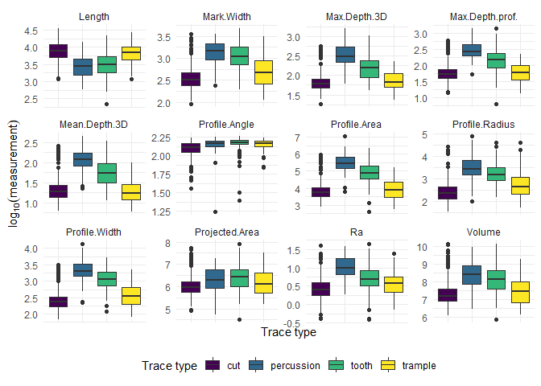
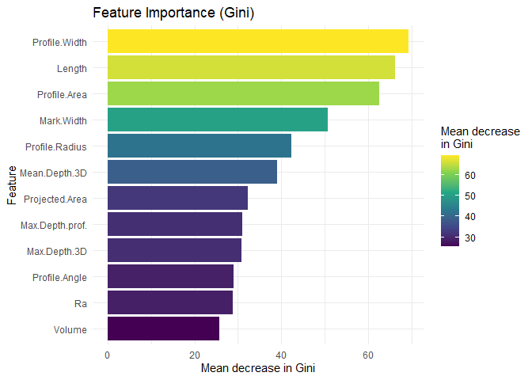

# ARCHY-459-week-4


``` r
library(tidyverse)
```

    Warning: package 'tidyverse' was built under R version 4.5.3

    Warning: package 'ggplot2' was built under R version 4.5.3

    Warning: package 'tidyr' was built under R version 4.5.3

    Warning: package 'purrr' was built under R version 4.5.3

    Warning: package 'dplyr' was built under R version 4.5.3

    Warning: package 'forcats' was built under R version 4.5.3

    Warning: package 'lubridate' was built under R version 4.5.3

    ── Attaching core tidyverse packages ──────────────────────── tidyverse 2.0.0 ──
    ✔ dplyr     1.2.1     ✔ readr     2.1.5
    ✔ forcats   1.0.1     ✔ stringr   1.5.1
    ✔ ggplot2   4.0.3     ✔ tibble    3.3.0
    ✔ lubridate 1.9.5     ✔ tidyr     1.3.2
    ✔ purrr     1.2.2     
    ── Conflicts ────────────────────────────────────────── tidyverse_conflicts() ──
    ✖ dplyr::filter() masks stats::filter()
    ✖ dplyr::lag()    masks stats::lag()
    ℹ Use the conflicted package (<http://conflicted.r-lib.org/>) to force all conflicts to become errors

``` r
library(tidymodels)
```

    Warning: package 'tidymodels' was built under R version 4.5.3

    ── Attaching packages ────────────────────────────────────── tidymodels 1.5.0 ──
    ✔ broom        1.0.13     ✔ rsample      1.3.2 
    ✔ dials        1.4.4      ✔ tailor       0.1.0 
    ✔ infer        1.1.0      ✔ tune         2.1.0 
    ✔ modeldata    1.6.0      ✔ workflows    1.3.0 
    ✔ parsnip      1.6.1      ✔ workflowsets 1.1.1 
    ✔ recipes      1.4.0      ✔ yardstick    1.4.0 

    Warning: package 'broom' was built under R version 4.5.3

    Warning: package 'dials' was built under R version 4.5.3

    Warning: package 'scales' was built under R version 4.5.3

    Warning: package 'infer' was built under R version 4.5.3

    Warning: package 'modeldata' was built under R version 4.5.3

    Warning: package 'parsnip' was built under R version 4.5.3

    Warning: package 'recipes' was built under R version 4.5.3

    Warning: package 'rsample' was built under R version 4.5.3

    Warning: package 'tailor' was built under R version 4.5.3

    Warning: package 'tune' was built under R version 4.5.3

    Warning: package 'workflows' was built under R version 4.5.3

    Warning: package 'workflowsets' was built under R version 4.5.3

    Warning: package 'yardstick' was built under R version 4.5.3

    ── Conflicts ───────────────────────────────────────── tidymodels_conflicts() ──
    ✖ scales::discard() masks purrr::discard()
    ✖ dplyr::filter()   masks stats::filter()
    ✖ recipes::fixed()  masks stringr::fixed()
    ✖ dplyr::lag()      masks stats::lag()
    ✖ yardstick::spec() masks readr::spec()
    ✖ recipes::step()   masks stats::step()

``` r
library(randomForest)
```

    Warning: package 'randomForest' was built under R version 4.5.3

    randomForest 4.7-1.2
    Type rfNews() to see new features/changes/bug fixes.

    Attaching package: 'randomForest'

    The following object is masked from 'package:dplyr':

        combine

    The following object is masked from 'package:ggplot2':

        margin

``` r
library(parsnip)

tidymodels_prefer()
```

# Import and tidy

``` r
marks <- read.csv("data sheet 3.csv") |>
  mutate(Trace.Type = factor(str_to_lower(Trace.Type)))
```

Split the data

``` r
#|label: split

set.seed(459)
marks_split <- initial_split(marks, prop = 0.8, strata =Trace.Type)
marks_train <- training(marks_split)
marks_test <- testing(marks_split)
```

``` r
#|label: measurements-plot
#|Fig-cap: "This measurment plot compares the four different trace types of 12 variables from the dataset. Similarities between cut and trample types share similarities in many of the variables explored in the dataset, which may cause issues in while using random forest. The values are not the exact same, but consistency of similarities could cause confusion to the model. This possible confusion between the two similar types could cause the model to memorize the data instead of recognizing patterns, and also might lead to a slightly lower mean decrease in Gini."

marks_train |>
  select(Trace.Type, Projected.Area:Ra) |>
  pivot_longer(
    cols = -Trace.Type,
    names_to = "feature",
    values_to = "value"
  ) |>
  ggplot(aes(x = Trace.Type, y = log10(value), fill = Trace.Type)) +
  geom_boxplot() +
  facet_wrap(~feature, scales = "free_y") +
  scale_fill_viridis_d() +
  labs(
    x = "Trace type",
    y = expression(log[10](measurement)),
    fill = "Trace type"
  ) +
  theme_minimal() +
  theme(
    axis.text.x = element_blank(),
    legend.position = "bottom"
  )
```



## Baseline

``` r
clas_props <-
marks_train |>
  count(Trace.Type) |>
  mutate(prop = n / sum(n))

baseline_accuracy <- round(max(clas_props$prop), 2)
```

Our baseline accuracy is ‘r baseline_accuracy’, so any model we create
must beat this number to be useful

``` r
marks_rec <-
recipe(Trace.Type ~ . ,
       data = marks_train) |>
  update_role(all_nominal_predictors(),
              new_role = "metadata")
```

## One Random Forest and its Out of Bag error

``` r
#|lable: rf

# model specifications: 3 measures tried per split
rf_spec <-
  rand_forest(mtry = 3, trees = 500) |>
  set_engine("randomForest", importance = TRUE) |>
  set_mode("classification")

#fit the recipe and spec to our training set
set.seed(459)
rf_one <- workflow(marks_rec, rf_spec) |>
  fit(marks_train)

rf_engine <- extract_fit_engine(rf_one)

oob_accuracy <- accuracy_vec(truth = marks_train$Trace.Type,
                             estimate = rf_engine$predicted)
```

Out of Bag accuracy of our model is ‘r round(oob_accuracy, 2)’

\##Feature importance

``` r
#|label: feature-importance
#|fig-cap: "After training the data, the calculated baseline accuracy is the way you can tell how good a random forest is by comparing the accuracy of the model used to the baseline accuracy. The forest can go wrong if it is not trained properly or if the recipe/specifications are not fit prperly to the training set. The use of Gini feature importance can calculated how relevant a feature is to the data and its contribution to the model's predication accuracy."

importance(rf_engine) |>
  as.data.frame() |>
  rownames_to_column("feature") |>
  select(feature, MeanDecreaseGini) |>
  mutate(feature = fct_reorder(feature, MeanDecreaseGini)) |>
  ggplot(aes(x = feature, y = MeanDecreaseGini, fill = MeanDecreaseGini)) +
  geom_col() +
  coord_flip() +
  scale_fill_viridis_c() +
  labs(
    title = "Feature Importance (Gini)",
    x = "Feature",
    y = "Mean decrease in Gini",
    fill = "Mean decrease\nin Gini"
  ) +
  theme_minimal()
```


